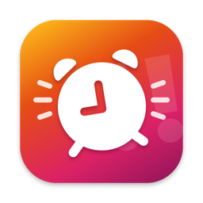
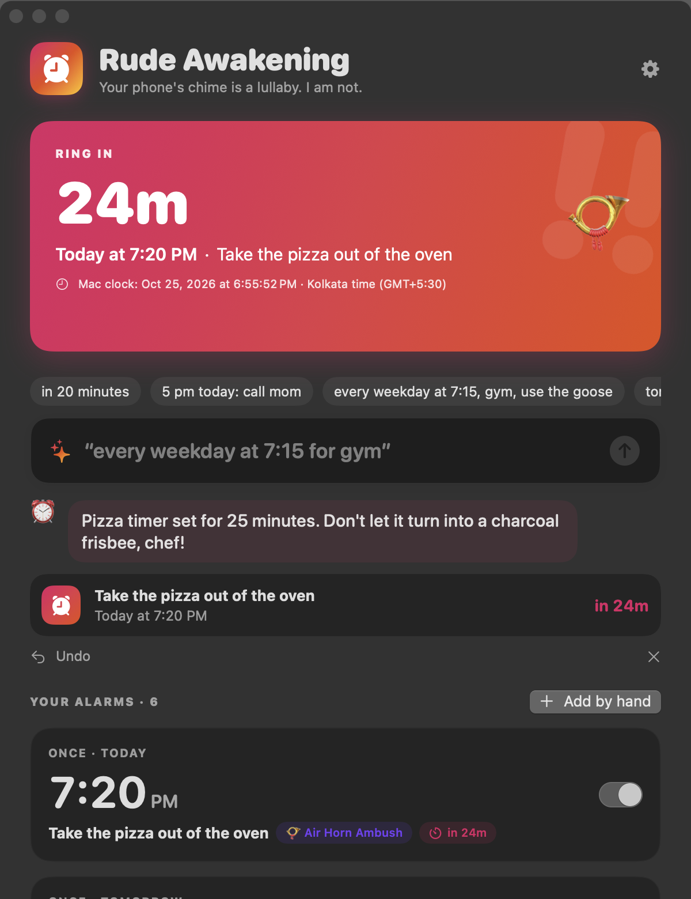
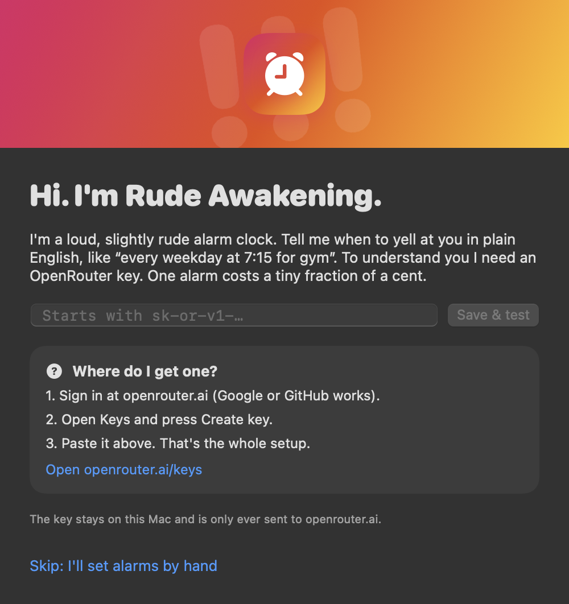
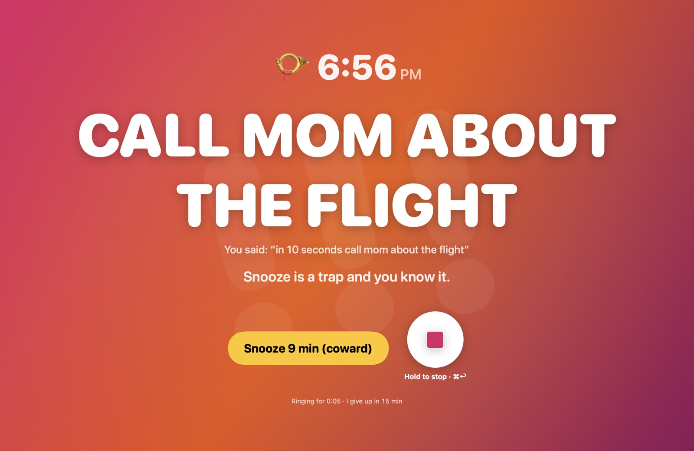
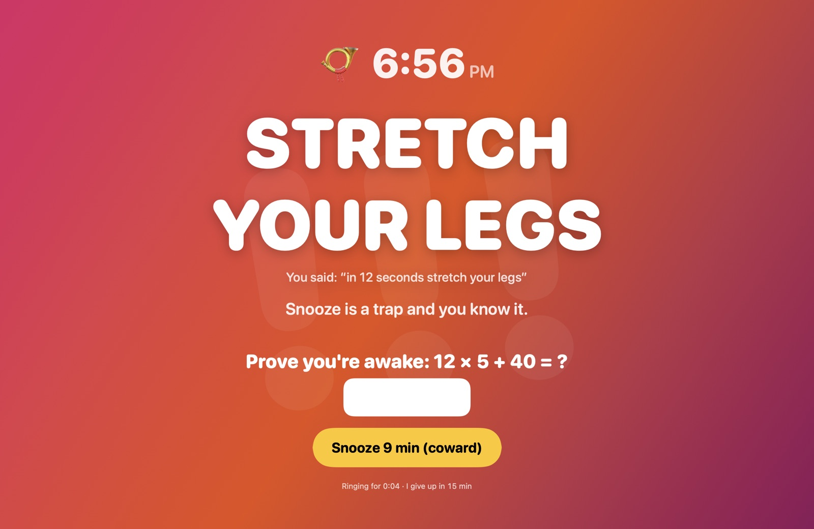
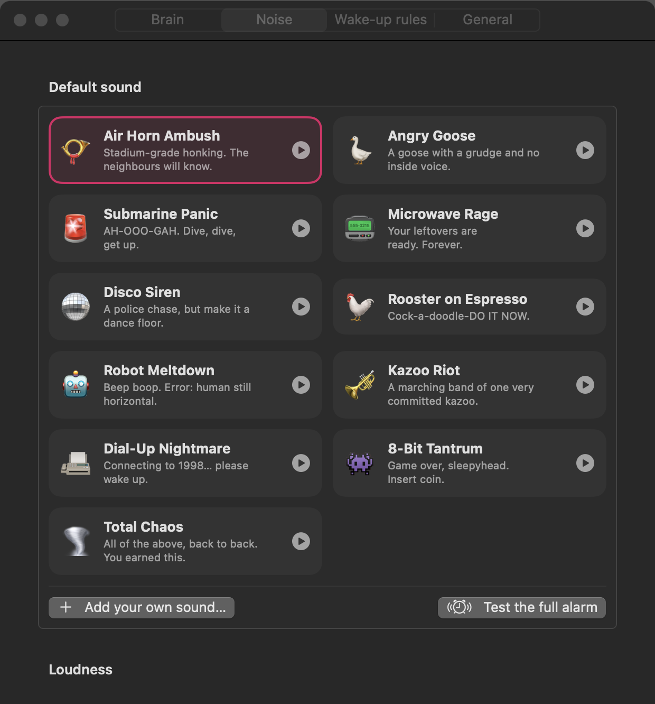
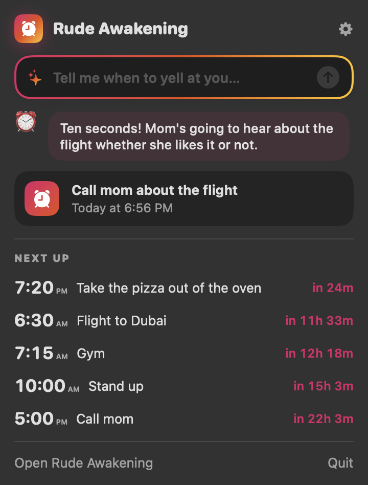

<p align="center">
  
</p>

<h1 align="center">Rude Awakening</h1>

<p align="center">
  <b>A loud, cheeky, native Mac alarm clock you set by typing a sentence.</b><br>
  “every weekday at 7:15 for gym, use the goose” → done.
</p>

<p align="center">
  <a href="https://github.com/adoistic/rude-awakening/actions/workflows/ci.yml"></a>
  
  
  <a href="LICENSE"></a>
</p>

<p align="center">
  
</p>

macOS reminders are polite. A polite notification slides in, sits in the corner and leaves. Rude Awakening takes over every screen, turns your volume up to 100%, blasts an air horn (or an angry goose), yells **what the alarm is for** out loud, and turns the volume back up if you try to turn it down.

You set alarms by typing like a person: “in 20 minutes”, “5 pm today, call mom”, “every 45 minutes from 10 to 6 on weekdays: stand up”. An LLM on [OpenRouter](https://openrouter.ai) works out what you meant, and the app does the date maths against your Mac's clock, so “tomorrow” really is tomorrow.

## Install

You need macOS 14 Sonoma or newer, on Apple silicon or Intel.

**One line** (downloads the latest release into Applications):

```bash
curl -fsSL https://raw.githubusercontent.com/adoistic/rude-awakening/main/install.sh | bash
```

**Or download it:** grab `Rude-Awakening-x.y.z.zip` from [Releases](https://github.com/adoistic/rude-awakening/releases), unzip, and drag **Rude Awakening** into Applications. The app is open source and not notarised by Apple, so the first time you open it macOS will say it can't check it. Open **System Settings › Privacy & Security**, scroll down and click **Open Anyway**. Or run this once:

```bash
xattr -dr com.apple.quarantine "/Applications/Rude Awakening.app"
```

**Or build it yourself.** You only need the Xcode Command Line Tools (`xcode-select --install`), not the full Xcode:

```bash
git clone https://github.com/adoistic/rude-awakening.git && cd rude-awakening && scripts/build-app.sh --install
```

## Set up: one key, once

1. Make a free account at [openrouter.ai](https://openrouter.ai) and create a key at [openrouter.ai/keys](https://openrouter.ai/keys). Add a few dollars of credit; a dollar covers thousands of alarms.
2. Open Rude Awakening and paste the key when it asks. It tests the key and saves it.

<p align="center">
  
</p>

That's the whole setup. Without a key, a small offline parser still handles simple things like “in 20 min” and “tomorrow at 7”, and you can always set alarms by hand.

## Things you can type

| You type | You get |
|---|---|
| `wake me up in 20 minutes` | One alarm, 20 minutes from now |
| `set an alarm in the next few hours at 5 pm today` | Today at 5:00 PM |
| `at 5` (at 4:35 PM) | Today at 5:00 PM, the next 5 o'clock that's coming up |
| `tomorrow 6:30am, flight to Dubai, be brutal` | Tomorrow 6:30 AM, labelled *Flight to Dubai*, air horn |
| `on friday at 9` / `3 november at 10:30` / `christmas morning` | The right date, from the Mac's calendar |
| `alarms at 6, 6:10 and 6:20 tomorrow` | Three alarms |
| `every weekday at 7:15 for gym, use the goose` | Mon–Fri 7:15 AM, labelled *Gym*, Angry Goose |
| `every day except sunday at 6:45` | Mon–Sat |
| `every 45 minutes from 10am to 6pm on weekdays: stand up` | 10:00, 10:45 … 5:30, weekdays only |
| `every other day at 9` / `1st of every month at noon: rent` / `every year on march 3` | Daily, monthly and yearly repeats |
| `wake me at 7 every day for the next 5 days` | A daily alarm that stops by itself |
| `दो घंटे बाद उठा देना` | Any language works |
| `kill the gym alarm` / `move my gym alarm to 8` / `delete all my alarms` | Changes the alarms you already have |

Every request shows a cheeky reply plus a card with the exact time it will ring, so you can see what it understood. Undo is one click (⌘Z).

## When it rings

<p align="center">
  
</p>

- **What the alarm is for is the headline.** “CALL MOM” in giant letters, with what you typed underneath. If several alarms go off together, you see every one.
- **Full screen, on every display, above everything,** and it wakes a sleeping screen.
- **Volume goes to 100%** (you choose the level), and comes back to where it was when you stop. **Volume lock**: turn it down and it turns itself back up, and keeps count.
- **It yells the reason out loud** between blasts: “Hey! It's 7:15. Gym!”
- **Hold to stop.** You have to press and hold the stop button for a second, so a sleepy flail doesn't count. ⌘Return works too. Want it harder? Turn on **Prove you're awake** and solve a sum first.
- **Snooze** is one press (9 minutes by default, labelled *coward*).
- It gives up after 15 minutes (or whenever you like, or never), then tells you that you slept through it.

<p align="center">
  
</p>

## The noises

<p align="center">
  
</p>

All ten are made from scratch by the app's own synthesiser at launch (oscillators, filters and noise), so there are no audio files, no licences and no two-second ringtones. You can also add your own sound file.

| | | |
|---|---|---|
| 📯 **Air Horn Ambush** | 🪿 **Angry Goose** | 🚨 **Submarine Panic** (AH-OOO-GAH) |
| 📟 **Microwave Rage** (classic beeps at 2.9 kHz, where ears are most sensitive) | 🪩 **Disco Siren** | 🐓 **Rooster on Espresso** |
| 🤖 **Robot Meltdown** | 🎺 **Kazoo Riot** | 📠 **Dial-Up Nightmare** |
| 👾 **8-Bit Tantrum** | 🌪️ **Total Chaos** (all of them, back to back) | 🎵 Your own file |

## Everything else

- **Menu bar countdown** (⏰ 2h 13m) with a panel for typing alarms and seeing what's next.
- **Quick alarm from anywhere:** press **⌥⌘A** in any app, type, press Return. No window switching.
- **Set alarms by hand** too: once, every day, weekdays, weekends, chosen days, every N days, monthly, yearly or every N minutes, with an optional end date.
- **Keeps the Mac awake** while alarms are set (idle sleep only; the screen can still turn off), so they actually ring.
- **Catches up after sleep:** an alarm that came due while the Mac was asleep rings when it wakes (up to an hour late), or shows up as missed.
- **Opens at login**, if you want it to.
- **Follows the Mac's clock and time zone.** Repeating alarms are wall-clock times, so 7:00 stays 7:00 across daylight saving changes and travel.

<p align="center">
  
  &nbsp;&nbsp;
  
</p>

## Good to know

- Alarms only ring while the app is running and the Mac is awake. Closing a laptop lid puts the Mac to sleep, and no app can ring through that. Leave the lid open, or plugged in with an external display.
- Sound plays through whatever output is active, so if headphones are plugged in, that's where the air horn goes.
- If you quit, it warns you how many alarms won't ring.

## Privacy

- Your OpenRouter key is stored only on your Mac, in `~/Library/Application Support/Rude Awakening/openrouter-key`, readable only by your user account. It is only ever sent to `openrouter.ai`.
- Each request sends OpenRouter the sentence you typed, the current date, time and time zone, and a short list of your existing alarms (label and schedule) so it can change them. Nothing else, and there's no analytics.
- Alarms live in `alarms.json` in the same folder.

## How it works

```
"every weekday at 7:15 for gym"
        │
        ▼
  OpenRouter (Claude Haiku 5.5 by default, any model works)
  gets: the sentence, the Mac's date/time/time zone, a calendar of the next 3 weeks,
        your current alarms, and a strict JSON schema
  returns: intent only — {kind: repeat, frequency: weekly, weekdays: [mon…fri], time: 07:15, label: Gym}
        │
        ▼
  PlanResolver (on your Mac, deterministic)
  turns intent into real dates with Foundation's Calendar: "in 20 min" is now + 20 min,
  a time that already passed today moves to tomorrow (and says so), bad dates are rejected
        │
        ▼
  AlarmEngine ticks every second, rings what is due, handles snooze, missed alarms and sleep
```

The model never does date arithmetic: relative times come back as offsets and the app adds them to the clock. That is why “in 2 hours and 15 minutes” is exact, every time.

```
Sources/
  AlarmCore/       models, repeat rules, the prompt and schema, the OpenRouter client,
                   the offline parser, the sound synthesiser (no UI, fully tested)
  RudeAwakening/   the Mac app: SwiftUI views in AppKit windows, Core Audio volume control,
                   AVAudioEngine playback, the global shortcut, the menu bar item
  rudectl/         a command-line tool for trying sentences, running evals and exporting sounds
Tests/             Swift Testing: recurrence edge cases, DST, the resolver, the engine, the sounds
```

## Development

```bash
swift build                      # build everything
swift test                       # 39 tests: repeats, DST, months, the engine, parsing, sounds
scripts/build-app.sh --install   # build the .app and put it in /Applications

export OPENROUTER_API_KEY=sk-or-v1-…
swift run rudectl parse "every other day at 9am"   # see what a sentence becomes
swift run rudectl eval                             # 31 real sentences at a fixed "now"
swift run rudectl eval google/gemini-3.8-flash     # try another model
swift run rudectl sounds ./sounds                  # write every alarm sound as a WAV
```

Set `RUDE_AWAKENING_SILENT=1` when launching the app to test the ringing flow without sound or volume changes.

There is also a scripted test harness that drives the real app without a mouse: launch it with `RUDE_AWAKENING_AUTOMATION=/some/folder` and append commands to `/some/folder/commands.txt` (`say every weekday at 7:15 for gym`, `ring`, `snooze`, `snap main main`, `quit`, and so on; the full list is at the top of [Automation.swift](Sources/RudeAwakening/Automation.swift)). It runs silently, keeps its windows off-screen, uses its own data and settings, and saves window snapshots as PNGs. The screenshots in this README came from it. Point it at a folder on your internal disk: macOS asks for permission each time a freshly built app touches an external drive.

The default model, `anthropic/claude-haiku-5.5`, passes all 31 eval sentences and answers in about two seconds. You can pick another in **Settings › Brain**.

## Design notes

Native controls only (SwiftUI and AppKit, SF Symbols, system materials), with the cheek in the copy, the colours and the noises. Patterns borrowed from good alarm and AI apps on Mobbin:

- The “Ring in 12h 24m” headline from [Me+](https://mobbin.com/screens/938e0261-4a82-4665-a98f-1edfa8726fed), and the small-caps repeat line over a huge time from [Eight Sleep](https://mobbin.com/screens/f1464e5a-cfed-4785-9aa5-06aabe8c9c26) and [WHOOP](https://mobbin.com/screens/7af269fb-2a3b-40f9-8730-8ae018912a96).
- Press-and-hold to stop from [Pillow](https://mobbin.com/screens/d54a6c0a-137c-472d-883a-b3fc76940e4b); full-bleed alarm colour from [Rivian](https://mobbin.com/screens/c25ddb40-e4a0-4f77-a9a6-9996a8afa4ed).
- Reply-then-result card from [Saturn](https://mobbin.com/screens/a615b79e-db8e-4de6-ab6c-96cb75fc9e56); example chips above the input from [Structured](https://mobbin.com/screens/ba22f03f-6ce9-4bbb-be66-1b0b01e7a049).
- The key screen's help box from [Bolt.new](https://mobbin.com/screens/7538011a-4f52-4c28-826a-3c044cab8203).

## License

MIT. Made by Adnan at [Thothica](https://thothica.com). Be loud responsibly.
